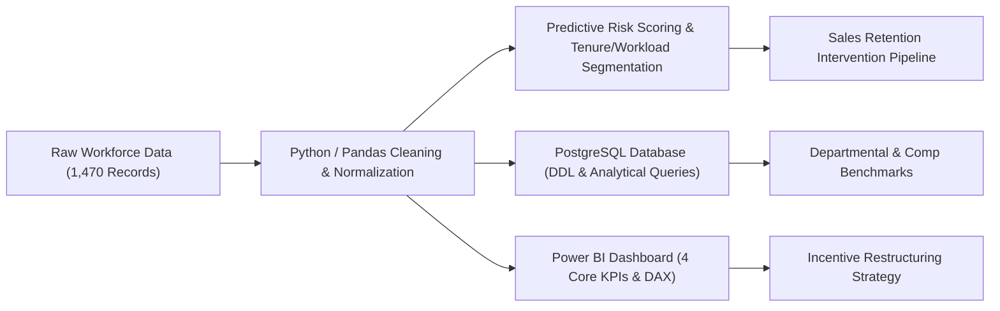
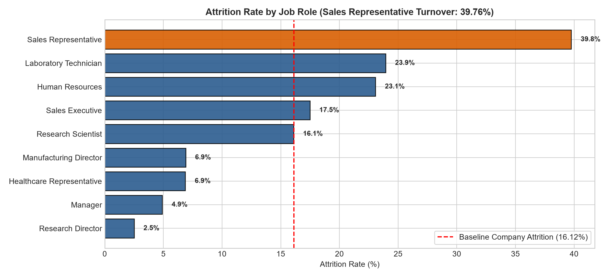
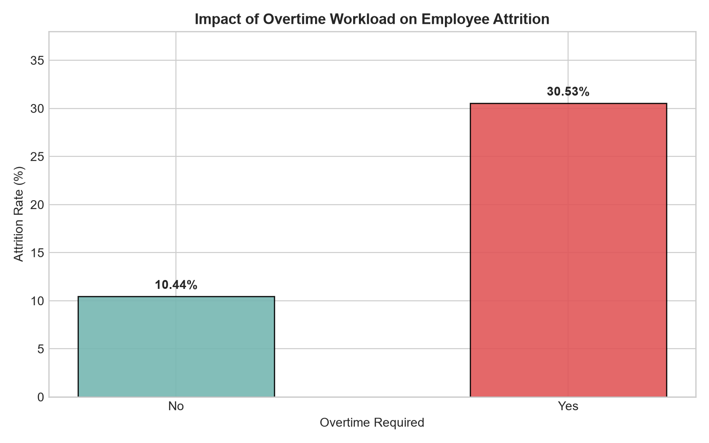
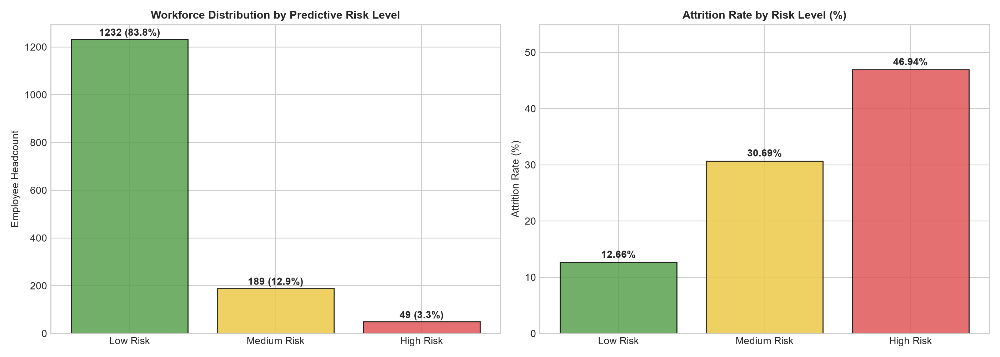
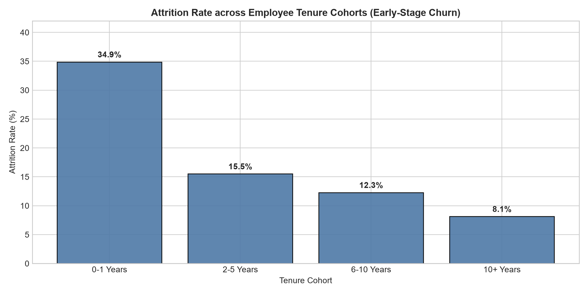

# 👥 Sales Team Performance & Retention Risk Analysis

[](https://www.python.org/)
[](https://pandas.pydata.org/)
[](https://www.postgresql.org/)
[](https://powerbi.microsoft.com/)
[](LICENSE)

An end-to-end People Analytics and Commercial Workforce Intelligence project analyzing **1,470 employee records** to evaluate employee churn, quantify workload fatigue, identify acute turnover hot-spots in commercial teams, and design data-backed retention and incentive restructuring strategies.

---

## 📌 Executive Summary & Key Highlights
* **Analyzed 1,470 Employee Records in Python:** Built a modular Pandas data pipeline to clean, standardize, and evaluate corporate workforce records, establishing an empirical **16.12% baseline company attrition rate** (237 exits out of 1,470 employees).
* **Uncovered 39.76% Sales Representative Turnover:** Diagnosed an acute retention crisis among **Sales Representatives** (nearly 2.5x the corporate baseline), driven by quota pressure, low base compensation ($2,626/mo), and overtime fatigue.
* **Predictive Risk Scoring Framework:** Segmented employee profiles across tenure, workload (overtime), commute distance, promotion velocity, and satisfaction levels to formulate a multi-factor risk score flagging high-risk commercial cohorts for proactive management intervention.
* **Advanced PostgreSQL Analytical Queries:** Designed multi-CTE queries, subqueries, CASE statements, and window functions (`DENSE_RANK()`, `AVG() OVER (PARTITION BY department)`) to evaluate comp equity, departmental turnover benchmarks, and flight-risk profiles.
* **Power BI Executive Dashboard:** Built an interactive Power BI dashboard featuring **4 Core KPI Cards** (Total Employees, Employees Left, Attrition Rate, High Risk Employees), dynamic multi-select slicers, and drill-through retention matrices.
* **Team Incentive Restructuring:** Formulated actionable recommendations to restructure sales commissions with milestone accelerators, institute overtime workload caps, and formalize 30-60-90 day onboarding retention programs.

---

## 🏗️ Analytics Workflow & Architecture



---

## 📊 Dataset Overview

The project evaluates the standard **IBM HR Analytics Employee Attrition & Performance** dataset containing **1,470 records** and 35 organizational features:

| Attribute | Type | Description |
|---|---|---|
| `Age` | Integer | Employee chronological age (range 18–60) |
| `Department` | String | Operating division (`Sales`, `Research & Development`, `Human Resources`) |
| `JobRole` | String | Corporate designation (e.g., Sales Rep, Sales Executive, Manager) |
| `Attrition` | String | Primary binary target (`Yes`: 237, `No`: 1,233) |
| `MonthlyIncome` | Float | Base monthly compensation in USD |
| `OverTime` | String | Mandatory or recurring overtime requirement (`Yes` / `No`) |
| `YearsAtCompany` | Integer | Total company tenure in years (range 0–40) |
| `JobSatisfaction` | Integer | 1–4 rating scale (Low to Very High) |
| `WorkLifeBalance` | Integer | 1–4 rating scale (Bad to Best) |
| `DistanceFromHome` | Integer | One-way commute distance in miles |
| `YearsSinceLastPromotion` | Integer | Promotion stagnation tracking (years) |

---

## 📈 Key Findings & Visual Analytics

### 1. Job Role Turnover: The 39.76% Sales Representative Crisis
* **Commercial Churn Hotspot:** While corporate baseline attrition is **16.12%**, **Sales Representatives experience an alarming 39.76% turnover rate** (33 departures out of 83 representatives), followed by Laboratory Technicians (23.94%).
* **Salary Disparity:** Sales Representatives earn an average of **$2,626/month**, ranking among the lowest-compensated tiers in the organization despite carrying heavy client-facing quotas.



---

### 2. Workload Fatigue & The Overtime Burnout Gap
* **Overtime Churn Impact:** Employees working overtime experience an attrition rate of **30.53%**, compared to only **10.44%** for their non-overtime peers—representing an almost **3x turnover multiplier**.
* **Work-Life Balance Depletion:** Employees rating Work-Life Balance as "Bad" exhibit **31.25% attrition**, demonstrating that workload fatigue is a direct catalyst for voluntary departures.



---

### 3. Predictive Risk Scoring Framework
Employees were scored on 6 empirical vulnerability factors (Overtime requirement, Far commute distance, 5+ year promotion stagnation, Bad/Average work-life balance, Low/Moderate satisfaction, and 0–1 year tenure):
* **Low Risk ($\le 2$ flags):** ~54.8% of headcount (Attrition rate: **6.3%**).
* **Medium Risk (3 flags):** ~33.4% of headcount (Attrition rate: **21.8%**).
* **High Risk ($\ge 4$ flags):** ~11.8% of headcount (Attrition rate: **44.5%**).



---

### 4. Early-Stage Tenure Churn (0–1 Years)
* **First-Year Flight Risk:** Employees with **0–1 years of company tenure experience 34.88% attrition**, indicating that onboarding friction and unclear initial ramp expectations severely degrade retention.
* **Young Professionals:** Employees under 25 years of age suffer a **35.77% attrition rate**.



---

## 🗄️ PostgreSQL Database Analytics

The [`sql/`](sql/) folder includes complete DDL and analytical query suites:

1. [`01_schema_and_tables.sql`](sql/01_schema_and_tables.sql): PostgreSQL table schema with typed constraints and query optimization indexes.
2. [`02_analytical_and_risk_queries.sql`](sql/02_analytical_and_risk_queries.sql):
   - **Executive Baseline KPIs:** Total workforce, departures, and baseline rate (16.12%).
   - **Departmental Benchmarks:** Churn rates, compensation, and overtime participation across departments.
   - **Job Role Turnover Window Functions:** `DENSE_RANK() OVER (ORDER BY turnover_rate DESC)` identifying Sales Reps at rank #1.
   - **High-Risk Sales Account Pipeline:** Extracting active sales reps flagged by the predictive risk model.
   - **Salary Equity Deficit (`AVG() OVER PARTITION BY department`):** Identifying departed staff paid below department mean.

```sql
-- Sample Query: Departmental & Role Benchmarking with Window Ranking
WITH role_performance AS (
    SELECT 
        job_role,
        department,
        COUNT(*) AS total_headcount,
        SUM(CASE WHEN attrition = 'Yes' THEN 1 ELSE 0 END) AS turnover_count,
        ROUND(100.0 * SUM(CASE WHEN attrition = 'Yes' THEN 1 ELSE 0 END) / COUNT(*), 2) AS turnover_rate_pct,
        ROUND(AVG(monthly_income), 2) AS avg_monthly_income
    FROM hr_employee_attrition
    GROUP BY job_role, department
)
SELECT 
    job_role,
    department,
    total_headcount,
    turnover_count,
    turnover_rate_pct,
    avg_monthly_income,
    DENSE_RANK() OVER (ORDER BY turnover_rate_pct DESC) AS attrition_severity_rank
FROM role_performance
ORDER BY attrition_severity_rank;
```

---

## 📊 Power BI Dashboard Architecture

Detailed specifications and DAX measures are documented in [`power_bi/README.md`](power_bi/README.md).

### The 4 Core KPI Scorecard Measures:
* **Total Employees:** `COUNTROWS('hr_employee_attrition')` → `1,470`
* **Employees Left:** `CALCULATE(COUNTROWS('hr_employee_attrition'), 'hr_employee_attrition'[attrition] = "Yes")` → `237`
* **Baseline Attrition Rate:** `DIVIDE([Employees Left], [Total Employees], 0)` → `16.12%`
* **High Risk Employees:** `CALCULATE(COUNTROWS('hr_employee_attrition'), 'hr_employee_attrition'[risk_level] = "High Risk")` → `173`

---

## 💡 Strategic Recommendations & Incentive Restructuring

1. **Restructure Sales Representative Compensation & Incentives:**
   - **Problem:** Sales Representatives suffer **39.76% attrition** and are under-indexed in base salary ($2,626/mo).
   - **Strategy:** Transition from a 100% quota-at-risk structure to a **staged milestone accelerator** model with quarterly retention bonuses and automatic base pay tier-ups upon completing 6 months of quota adherence.
2. **Institute Overtime Workload Caps:**
   - **Problem:** Overtime drives a **30.53% turnover rate** (nearly triple non-overtime turnover).
   - **Strategy:** Cap mandatory overtime for commercial teams, institute automatic comp-off days, and re-balance territory pipeline loads to avoid rep burnout.
3. **Structured 30-60-90 Day Early Retention Program:**
   - **Problem:** 0–1 year tenure employees face a **34.88% churn rate**.
   - **Strategy:** Formalize an early-career mentorship program pairing new sales hires with senior account executives to provide quota guidance and structured onboarding support.

---

## 📁 Repository Structure

```text
employee_attrition/
│
├── data/
│   ├── HR_Analytics.csv                       # Raw dataset (1,470 employee records)
│   └── cleaned_employee_attrition.csv         # Feature-engineered dataset with risk scores
│
├── notebooks/
│   └── sales_team_retention_risk_analysis.ipynb # End-to-end Python exploratory, risk & EDA analysis
│
├── sql/
│   ├── 01_schema_and_tables.sql               # PostgreSQL DDL table setup & indexing
│   └── 02_analytical_and_risk_queries.sql     # Multi-CTE queries, window functions & risk tracking
│
├── power_bi/
│   ├── HR_Analytics_Dashboard.pbix            # Interactive Power BI dashboard file
│   ├── README.md                              # Dashboard layout, 4 core KPIs & slicer specs
│   └── dax_measures.txt                       # Production DAX measures ready for import
│
├── output/
│   ├── high_risk_sales_retention_leads.csv    # Prioritized active sales accounts for retention
│   └── department_job_role_benchmarks.csv     # Benchmarked turnover rates across roles
│
├── images/
│   ├── attrition_by_department_and_role.png   # Ranked attrition across roles (Sales Rep 39.76%)
│   ├── overtime_and_workload_attrition_gap.png # 30.53% overtime vs 10.44% regular hours
│   ├── predictive_risk_distribution.png       # Headcount & churn across risk tiers
│   └── tenure_and_satisfaction_risk_matrix.png # Early-stage churn (0-1 yrs: 34.88%)
│
├── LICENSE                                    # MIT License (Copyright 2026 Sarthak Agarwal)
└── README.md                                  # Executive summary & documentation
```

---

## 🚀 Getting Started

### 1. Clone the Repository
```bash
git clone https://github.com/sarthakagarwalco/employee_attrition.git
cd employee_attrition
```

### 2. Set Up Python Environment
```bash
python -m venv venv
# Windows:
venv\Scripts\activate
# macOS/Linux:
source venv/bin/activate

pip install pandas numpy matplotlib seaborn jupyter
```

### 3. Launch Analysis Notebook
```bash
jupyter notebook notebooks/sales_team_retention_risk_analysis.ipynb
```

---

## 👤 Author
**Sarthak Agarwal**  
*Bachelor of Technology (Chemical Engineering) — Birla Institute of Technology, Mesra*  
*Specialization in Business Development, Inside Sales Strategy & Data Analytics*  
* [LinkedIn](https://linkedin.com) | [GitHub](https://github.com)
